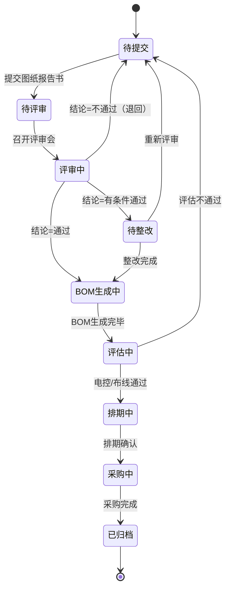

# 新增机图纸评审流程 — 系统设计文档

> 版本：v1.0  
> 日期：2026-10-14  
> 关联 PRD：`docs/新增机图纸评审流程_PRD.md`  
> 关联分析：`docs/图纸评审流程对比分析.md`

---

## 1. 设计目标与范围

### 1.1 目标
将 PRD 中的线下/半线下流程转化为可落地的数字化工作流，实现：
- 图纸评审单为流程主线；
- 评审会议自动预约；
- 评审结论驱动下游 BOM、电控/布线评估、采购、生产、发货；
- 全流程状态可追踪、可预警。

### 1.2 设计范围
- 业务实体与数据模型
- 流程状态机
- 系统集成边界
- 飞书多维表格（Base）落地结构
- 核心模块职责与调用关系
- 异常与回退机制

### 1.3 不在首期范围
- 与 PLM 的深度集成；
- 供应商门户在线报价；
- 与 MES 的实时双向同步；
- 复杂甘特图/APS 排程算法。

---

## 2. 总体架构

```
┌─────────────────────────────────────────────────────────────────┐
│                        用户层（入口）                            │
│  飞书工作台 / Web 端 / 企业微信 / 钉钉（未来扩展）                │
└─────────────────────────────────────────────────────────────────┘
                              ↓
┌─────────────────────────────────────────────────────────────────┐
│                      应用层（NEC Hub）                           │
│  ┌─────────┐ ┌─────────┐ ┌─────────┐ ┌─────────┐ ┌─────────┐  │
│  │ 评审中心 │ │ 会议中心 │ │ BOM中心 │ │ 采购中心 │ │ 仓储中心 │  │
│  └─────────┘ └─────────┘ └─────────┘ └─────────┘ └─────────┘  │
│  ┌─────────┐ ┌─────────┐ ┌─────────┐                          │
│  │ 评估中心 │ │ 排期中心 │ │ 流程看板 │                          │
│  └─────────┘ └─────────┘ └─────────┘                          │
└─────────────────────────────────────────────────────────────────┘
                              ↓
┌─────────────────────────────────────────────────────────────────┐
│                      流程编排层                                  │
│         状态机引擎 + 事件总线 + 定时任务                         │
└─────────────────────────────────────────────────────────────────┘
                              ↓
┌─────────────────────────────────────────────────────────────────┐
│                      数据层                                      │
│  飞书 Base（主数据）+ D1 / KV（运行时）+ OSS（文件）              │
└─────────────────────────────────────────────────────────────────┘
                              ↓
┌─────────────────────────────────────────────────────────────────┐
│                      外部集成                                    │
│  腾讯会议 │ ERP │ MES │ WMS │ 日历 │ 邮件/飞书消息               │
└─────────────────────────────────────────────────────────────────┘
```

---

## 3. 业务流程状态机

### 3.1 主流程状态



### 3.2 状态转换规则

| 当前状态 | 触发事件 | 下一状态 | 执行动作 |
|---------|---------|---------|---------|
| 待提交 | review.submit | 待评审 | 校验图纸、生成评审单、预约会议 |
| 待评审 | meeting.start | 评审中 | 锁定评审单、记录参会人 |
| 评审中 | review.conclusion=通过 | BOM生成中 | 触发 BOM 生成任务 |
| 评审中 | review.conclusion=有条件通过 | 待整改 | 生成整改任务 |
| 评审中 | review.conclusion=不通过 | 待提交 | 退回设计负责人 |
| 待整改 | rectification.complete | BOM生成中 | 校验整改项关闭 |
| BOM生成中 | bom.generated | 评估中 | 通知电控/布线负责人 |
| 评估中 | assessment.pass | 排期中 | 拉取库存、计算排期 |
| 评估中 | assessment.fail | 待提交 | 退回修改 |
| 排期中 | schedule.confirmed | 采购中 | 生成采购/加工任务 |
| 采购中 | procurement.complete | 已归档 | 生成最终归档包 |

---

## 4. 数据模型设计

### 4.1 实体关系图

```
[DrawingReview] 1 ── * [ReviewMinutes]
              1 ── 1 [BOM]
              1 ── * [Assessment]
              1 ── 1 [DeliveryList]
              1 ── 1 [ProjectSchedule]
              1 ── * [Inquiry]
              1 ── * [ProcessEvent]
              
[BOM] 1 ── * [BOMItem]

[DeliveryList] 1 ── * [DeliveryItem]

[ProjectSchedule] 1 ── * [ScheduleTask]
```

### 4.2 核心实体字段

#### DrawingReview（图纸评审单）
```typescript
interface DrawingReview {
  reviewId: string;           // DR-YYYYMMDD-NNN
  projectId: string;
  machineName: string;
  drawingVersion: string;
  designerId: string;
  drawingFiles: Attachment[];
  designNotes: string;
  status: ReviewStatus;
  meetingId?: string;
  meetingLink?: string;
  meetingStartTime?: string;
  conclusion?: 'passed' | 'conditional' | 'rejected';
  conclusionNotes?: string;
  createdAt: string;
  updatedAt: string;
}
```

#### ReviewMinutes（会议纪要）
```typescript
interface ReviewMinutes {
  minutesId: string;
  reviewId: string;
  meetingTime: string;
  attendees: User[];
  topics: string[];
  discussion: string;
  issues: ReviewIssue[];
  conclusion: 'passed' | 'conditional' | 'rejected';
  nextActions: ActionItem[];
  attachments: Attachment[];
}
```

#### BOM & BOMItem
```typescript
interface BOM {
  bomId: string;
  reviewId: string;
  version: string;
  totalCostEstimate?: number;
  status: 'draft' | 'confirmed';
}

interface BOMItem {
  itemId: string;
  bomId: string;
  parentItemId?: string;
  level: number;
  materialCode?: string;
  materialName: string;
  specification: string;
  quantity: number;
  unit: string;
  material?: string;
  process?: string;
  source: 'self-made' | 'purchased' | 'standard';
  drawingNo?: string;
  remark?: string;
}
```

#### Assessment（评估报告）
```typescript
interface Assessment {
  assessmentId: string;
  reviewId: string;
  type: 'electrical' | 'wiring';
  assessorId: string;
  content: string;            // 结构化 JSON
  result: 'pass' | 'fail';
  attachments: Attachment[];
}
```

#### DeliveryList（发货清单）
```typescript
interface DeliveryList {
  deliveryId: string;
  reviewId: string;
  batchNo: string;
  status: 'draft' | 'confirmed';
}

interface DeliveryItem {
  itemId: string;
  deliveryId: string;
  bomItemId: string;
  quantity: number;
  warehouseLocation?: string;
  mesLocation?: string;
  packageType: string;
  shippingMethod: string;
  estimatedDate: string;
  remark?: string;
}
```

#### Inquiry（询价单）
```typescript
interface Inquiry {
  inquiryId: string;
  reviewId: string;
  bomItemId: string;
  supplierId: string;
  quantity: number;
  price?: number;
  deliveryDate?: string;
  status: 'sent' | 'quoted' | 'selected' | 'rejected';
}
```

---

## 5. 飞书 Base 表结构设计（首期落地）

### 5.1 建议的 Base 分组

为降低首期实施复杂度，建议在一个 Base 内建立以下数据表：

| 表名 | 用途 | 记录量级 |
|------|------|---------|
| 图纸评审单 | 流程主线 | 数十 ~ 数百 |
| 会议纪要 | 每次评审一条 | 同评审单 |
| 整改项 | 有条件通过时产生 | 同评审单 |
| BOM 清单 | 评审通过后的物料清单 | 同评审单 × 物料数 |
| 评估报告 | 电控/布线评估 | 同评审单 |
| 库存查询结果 | 临时/快照 | 同 BOM |
| 发货清单 | 最终发货明细 | 同 BOM |
| 排期任务 | 各节点任务 | 同评审单 |
| 询价单 | 三家询价 | 同外购物料 × 3 |
| 流程事件日志 | 状态变更/操作记录 | 较多 |

### 5.1.1 已落地配置（2026-10-14）

Base `OFZqbJHteaYRpssam7Nc4fTYnLc`，10 张逻辑表全部建好并写入 KV 配置（`drawing-review:config`，可用 MCP `config_drawing_review action=get` 查看）：

| 逻辑表名 | 表名 | table_id |
|---------|------|----------|
| reviews | 图纸评审单 | tblHrJVvoa158UlI |
| minutes | 会议纪要 | tbluGs2dddz7VUEj |
| rectifications | 整改项 | tblHoM7W2zi5pDzs |
| bom | BOM清单 | tblWTH2AHxLsvRgt |
| assessments | 评估报告 | tblb4UDkNAqdzLlS |
| inventory | 库存 | tbl1PLfCGFk8lTrP |
| delivery | 发货清单 | tbleg0y2dgCuHqEg |
| schedule | 排期任务 | tbl7Uk8Mx8ctsjNK |
| inquiries | 询价单 | tblYyXKBJ3GwDiWx |
| events | 流程事件日志 | tbl4pGTFtnRy8X8r |

> 注意：`config_drawing_review action=set` 是全量覆盖，补配单张表时必须带上其余 9 张表的 table_id。

### 5.2 图纸评审单字段

| 字段名 | 类型 | 说明 |
|--------|------|------|
| 评审单号 | 自动编号 | DR-前缀 |
| 项目编号 | 文本 | |
| 机型名称 | 文本 | |
| 图纸版本 | 文本 | |
| 设计负责人 | 人员 | |
| 图纸文件 | 附件 | |
| 设计说明 | 多行文本 | |
| 状态 | 单选 | 待提交、待评审、评审中、待整改、BOM生成中、评估中、排期中、采购中、已归档 |
| 会议ID | 文本 | 腾讯会议 ID |
| 会议链接 | 文本 | |
| 评审结论 | 单选 | 通过、有条件通过、不通过 |
| 创建时间 | 创建时间 | |
| 更新时间 | 更新时间 | |

### 5.3 会议纪要字段

| 字段名 | 类型 | 说明 |
|--------|------|------|
| 关联评审单 | 关联 | 指向「图纸评审单」 |
| 会议时间 | 日期时间 | |
| 参会人员 | 人员（多选） | |
| 讨论记录 | 多行文本 | |
| 评审结论 | 单选 | |
| 会议纪要文件 | 附件 | |

### 5.4 整改项字段

| 字段名 | 类型 | 说明 |
|--------|------|------|
| 关联评审单 | 关联 | |
| 问题描述 | 多行文本 | |
| 提出人 | 人员 | |
| 责任人 | 人员 | |
| 截止日期 | 日期 | |
| 完成状态 | 单选 | 未完成/已完成 |

### 5.5 BOM 清单字段

| 字段名 | 类型 | 说明 |
|--------|------|------|
| 关联评审单 | 关联 | |
| 层级 | 数字 | 1/2/3/4 |
| 父级物料 | 关联（自引用） | |
| 物料编码 | 文本 | |
| 物料名称 | 文本 | |
| 规格型号 | 文本 | |
| 数量 | 数字 | |
| 单位 | 文本 | |
| 材质 | 文本 | |
| 加工工艺 | 单选 | 机加/钣金/焊接/注塑/标准件/外购 |
| 来源 | 单选 | 自制/外购/标准件 |
| 参考图号 | 文本 | |

### 5.6 询价单字段

| 字段名 | 类型 | 说明 |
|--------|------|------|
| 关联BOM项 | 关联 | 指向「BOM 清单」 |
| 供应商 | 文本 | |
| 需求数量 | 数字 | |
| 报价 | 数字/货币 | |
| 交期 | 日期 | |
| 状态 | 单选 | 待发送、已发送、已报价、已选中、已淘汰 |

> 已实现版本（`src/drawing-review/adapter.ts` createInquiry）实际写入的字段为：询价单号、关联评审单、关联物料、物料编码、物料名称、规格型号、供应商、需求数量、需求日期、报价、交期、状态（sent/quoted/selected/rejected）、创建时间，已按此建表。

### 5.7 评估报告字段（已建表 tblb4UDkNAqdzLlS）

| 字段名 | 类型 | 说明 |
|--------|------|------|
| 评估ID | 文本 | |
| 关联评审单 | 文本 | |
| 评估类型 | 单选 | electrical / wiring |
| 评估人 | 文本 | |
| 评估内容 | 文本 | 结构化 JSON |
| 结论 | 单选 | pass / fail |
| 附件 | 文本 | 附件 URL |
| 创建时间 | 文本 | ISO 时间串 |

### 5.8 库存查询结果字段（已建表 tbl1PLfCGFk8lTrP）

| 字段名 | 类型 | 说明 |
|--------|------|------|
| 物料名称 | 文本 | |
| 物料编码 | 文本 | |
| 关联评审单 | 文本 | |
| 库存数量 | 数字 | |
| 库存状态 | 单选 | 充足 / 不足 / 无库存（看板阻塞规则命中「不足」「无库存」） |
| 备注 | 文本 | |

### 5.9 发货清单字段（已建表 tbleg0y2dgCuHqEg）

| 字段名 | 类型 | 说明 |
|--------|------|------|
| 发货批次号 | 文本 | |
| 关联评审单 | 文本 | |
| 关联BOM项 | 文本 | |
| 数量 | 数字 | |
| 仓库库位 | 文本 | |
| MES库位 | 文本 | |
| 包装方式 | 文本 | |
| 运输方式 | 文本 | |
| 预计发货日期 | 文本 | |
| 状态 | 单选 | draft / confirmed |
| 备注 | 文本 | |

### 5.10 排期任务字段（已建表 tbl7Uk8Mx8ctsjNK）

| 字段名 | 类型 | 说明 |
|--------|------|------|
| 任务名称 | 文本 | |
| 关联评审单 | 文本 | |
| 节点 | 文本 | 流程节点名 |
| 负责人 | 文本 | |
| 开始日期 | 文本 | |
| 结束日期 | 文本 | |
| 状态 | 单选 | 待开始 / 进行中 / 已完成 |
| 备注 | 文本 | |

### 5.11 流程事件日志字段（已建表 tbl4pGTFtnRy8X8r）

| 字段名 | 类型 | 说明 |
|--------|------|------|
| 关联评审单 | 文本 | 评审单号 |
| 操作人 | 文本 | open_id |
| 动作 | 文本 | submit / start_meeting / conclude / inquiry_quote 等 |
| 原状态 | 文本 | |
| 新状态 | 文本 | |
| 附加信息 | 文本 | JSON 串 |
| 操作时间 | 文本 | ISO 时间串 |

> 评估报告、发货清单、排期任务三张表为预建结构：对应 service（评估中心/发货清单/排期中心，规划在阶段三）尚未实现，落地时如代码字段名与此处有出入，直接在 Base 里改字段名即可，配置无需变更。

---

## 6. 核心流程时序

### 6.1 提交图纸 → 预约会议

```sequence
User -> 评审中心: 提交图纸报告书
评审中心 -> 校验服务: 校验图纸完整性
校验服务 --> 评审中心: 通过
评审中心 -> 会议中心: requestMeeting(review)
会议中心 -> 腾讯会议API: 创建会议+邀请成员
腾讯会议API --> 会议中心: meetingId, joinUrl
会议中心 -> 评审中心: 保存会议信息
评审中心 -> 飞书Base: 创建评审单记录
评审中心 -> 消息服务: 通知参会人
消息服务 -> 飞书IM: 发送会议提醒
```

### 6.2 评审会 → 评审结论 → BOM 生成

```sequence
User -> 评审中心: 录入会议纪要+评审结论
评审中心 -> 飞书Base: 保存会议纪要
alt 结论=不通过
  评审中心 -> 评审中心: status=待提交
  评审中心 -> 消息服务: 通知设计负责人修改
else 结论=有条件通过
  评审中心 -> 飞书Base: 创建整改项
  评审中心 -> 评审中心: status=待整改
else 结论=通过
  评审中心 -> BOM中心: generateBOM(review)
  BOM中心 -> 飞书Base: 写入BOM清单
  BOM中心 -> 评审中心: BOM生成完成
  评审中心 -> 评估中心: 触发电控/布线评估
  评估中心 -> 消息服务: 通知电控/布线负责人
end
```

### 6.3 评估通过 → 库存拉取 → 发货清单 → 排期

```sequence
电控负责人 -> 评估中心: 提交电控评估报告
布线负责人 -> 评估中心: 提交布线评估报告
评估中心 -> 评审中心: 评估全部通过
评审中心 -> 仓储中心: pullInventory(bomItems)
仓储中心 -> ERP/WMS API: 查询库存
仓储中心 -> MES API: 查询库位/在制状态
仓储中心 -> 飞书Base: 写入库存查询结果
仓储中心 -> 评审中心: 库存数据就绪
评审中心 -> 仓储中心: generateDeliveryList()
仓储中心 -> 飞书Base: 生成发货清单
评审中心 -> 排期中心: generateSchedule()
排期中心 -> 日历API: 查询成员忙闲
排期中心 -> 飞书Base: 生成排期任务
```

### 6.4 排期确认 → 采购/加工 → 归档

```sequence
项目经理 -> 排期中心: 确认排期
排期中心 -> 采购中心: 触发采购
排期中心 -> 飞书Base: 标记加工任务
采购中心 -> 飞书Base: 生成三家询价单
采购负责人 -> 采购中心: 确认供应商/回填报价
采购中心 -> 飞书Base: 更新询价状态
采购中心 -> 评审中心: 采购完成
评审中心 -> 飞书Base: status=已归档
评审中心 -> 消息服务: 通知相关人员
```

---

## 7. 模块设计

### 7.1 评审中心（Review Center）

**职责：**
- 接收图纸报告书提交；
- 管理评审单生命周期；
- 协调其他中心；
- 提供评审单查询、详情、历史。

**核心服务：**
```typescript
class ReviewService {
  submitReview(input: SubmitReviewInput): Promise<DrawingReview>;
  scheduleMeeting(reviewId: string): Promise<MeetingInfo>;
  saveMinutes(reviewId: string, minutes: ReviewMinutes): Promise<void>;
  setConclusion(reviewId: string, conclusion: Conclusion): Promise<void>;
  completeRectification(reviewId: string): Promise<void>;
  getReviewDetail(reviewId: string): Promise<ReviewDetail>;
}
```

### 7.2 会议中心（Meeting Center）

**职责：**
- 调用腾讯会议 API 创建/更新/取消会议；
- 维护会议与评审单的映射；
- 会前提醒。

**核心服务：**
```typescript
class MeetingService {
  createMeeting(review: DrawingReview, attendees: User[]): Promise<MeetingInfo>;
  updateMeeting(meetingId: string, updates: MeetingUpdate): Promise<void>;
  cancelMeeting(meetingId: string): Promise<void>;
  sendReminder(meetingId: string): Promise<void>;
}
```

### 7.3 BOM 中心（BOM Center）

**职责：**
- 根据评审单和图纸信息生成 BOM；
- 支持手动调整；
- 拆分机械加工件 BOM。

**核心服务：**
```typescript
class BOMService {
  generateBOM(reviewId: string): Promise<BOM>;
  updateBOM(bomId: string, items: BOMItem[]): Promise<void>;
  exportMachiningBOM(bomId: string): Promise<BOMItem[]>;
}
```

### 7.4 评估中心（Assessment Center）

**职责：**
- 电控评估报告管理；
- 布线评估报告管理；
- 评估结果校验。

### 7.5 仓储中心（Inventory Center）

**职责：**
- 从 ERP/WMS 拉取库存；
- 从 MES 拉取库位/在制状态；
- 生成发货清单。

### 7.6 排期中心（Schedule Center）

**职责：**
- 获取成员日历忙闲；
- 基于工序周期生成关键路径；
- 输出排期任务。

### 7.7 采购中心（Procurement Center）

**职责：**
- 根据缺料 BOM 项生成询价单；
- 推荐供应商；
- 比价与采购建议。

### 7.8 流程看板（Process Dashboard）

**职责：**
- 汇总各评审单状态；
- 阻塞预警；
- 个人待办。

---

## 8. 集成接口设计

### 8.1 腾讯会议集成

| 能力 | 接口 | 用途 |
|------|------|------|
| 创建会议 | POST /v1/meetings | 自动预约评审会 |
| 查询会议 | GET /v1/meetings/{meeting_id} | 同步会议状态 |
| 获取录制 | GET /v1/meetings/{id}/recordings | 关联纪要 |

### 8.2 ERP 集成

| 能力 | 接口 | 用途 |
|------|------|------|
| 物料主数据 | GET /materials/{code} | 校验 BOM 物料 |
| 库存查询 | GET /inventory/{code} | 拉取库存数量 |
| 采购订单 | POST /purchase-orders | 生成采购订单 |

### 8.3 MES 集成

| 能力 | 接口 | 用途 |
|------|------|------|
| 库位查询 | GET /mes/location/{code} | 获取物料库位 |
| 在制状态 | GET /mes/wip/{code} | 获取在制完工日期 |
| 加工任务 | POST /mes/work-orders | 下发加工任务 |

### 8.4 日历集成

| 能力 | 接口 | 用途 |
|------|------|------|
| 查询忙闲 | POST /calendar/v4/freebusy/list | 成员排期 |
| 创建日程 | POST /calendar/v4/calendars/{id}/events | 写入排期任务 |

### 8.5 通知与 Webhook 集成

#### 8.5.1 出站：飞书群机器人通知（已实现）

复用 Worker secret `FEISHU_WEBHOOK_URL`（飞书群自定义机器人），所有通知经 `src/drawing-review/notify.ts` 的 `notifyFeishuGroup` 发送；未配置 webhook 时静默跳过，推送失败只记日志、不阻断主流程。

| 触发点 | 代码位置 | 消息内容 |
|--------|---------|---------|
| 评审单提交 | `flow.service.ts` submit | 评审单号、机型、版本、设计负责人 |
| 状态流转 | `flow.service.ts` transitionTo | 评审单号、机型、原状态 → 新状态、操作人 |
| 报价回填 | `inquiry.service.ts` quote | 询价单号、物料、供应商、报价、交期 |
| 供应商选定 | `inquiry.service.ts` compare | 评审单号、已选定物料清单 |
| 阻塞告警 | `alert.service.ts` pushBlockerAlerts | 看板阻塞规则命中项（见下） |

阻塞告警挂在每小时 cron（wrangler trigger `23 * * * *`）上，复用看板阻塞规则（待评审超 48h、待整改超 72h、询价超 72h 未报价、库存不足/无库存）。KV 去重（key `drawing-review:alert:blockers`）：同一 `reviewId+ruleId` 在持续阻塞期间只推一次，清除后再次出现会重新告警。

#### 8.5.2 入站：飞书事件订阅（预留，未实现）

目标：采购/仓储直接在多维表格里改记录（回填报价、改库存状态）时，无需走门户 API 即可驱动流程。

- 端点设计：`POST /api/drawing-review/webhook`，处理飞书事件订阅的 URL 校验（`challenge`）与事件回调；
- 订阅事件：`bitable.record.updated`（询价单、库存两张表）；
- 询价单报价回填 → 等价于 `POST /api/drawing-review/inquiries/:id/quote`；库存状态变更 → 触发看板缓存失效与阻塞重算；
- 前置条件：飞书开放平台配置事件订阅地址、`bitable:app` 相关权限、Encrypt Key 校验。实现前需在设计评审中确认幂等与重放防护方案。

---

## 9. 权限模型

### 9.1 角色权限矩阵

| 功能 | 设计负责人 | 机械评审 | 电控负责人 | 布线工程师 | 采购 | 生产 | 仓储 | 项目经理 |
|------|-----------|---------|-----------|-----------|------|------|------|---------|
| 提交图纸 | ✅ | ❌ | ❌ | ❌ | ❌ | ❌ | ❌ | ❌ |
| 修改评审单 | ✅(自己) | ❌ | ❌ | ❌ | ❌ | ❌ | ❌ | ✅ |
| 填写会议纪要 | ❌ | ✅ | ⚠️ | ⚠️ | ⚠️ | ⚠️ | ❌ | ✅ |
| 电控评估 | ❌ | ❌ | ✅ | ❌ | ❌ | ❌ | ❌ | ❌ |
| 布线评估 | ❌ | ❌ | ❌ | ✅ | ❌ | ❌ | ❌ | ❌ |
| 确认 BOM | ❌ | ✅ | ⚠️ | ⚠️ | ⚠️ | ⚠️ | ❌ | ✅ |
| 发起询价 | ❌ | ❌ | ❌ | ❌ | ✅ | ❌ | ❌ | ✅ |
| 确认发货清单 | ❌ | ❌ | ❌ | ❌ | ❌ | ⚠️ | ✅ | ✅ |
| 调整排期 | ❌ | ❌ | ❌ | ❌ | ❌ | ⚠️ | ⚠️ | ✅ |
| 全流程查看 | ⚠️ | ⚠️ | ⚠️ | ⚠️ | ⚠️ | ⚠️ | ⚠️ | ✅ |

> ⚠️ 表示可查看或部分操作

---

## 10. 异常处理与回退机制

### 10.1 会议预约失败
- 腾讯会议 API 失败时，状态保持「待评审」；
- 系统发送通知给项目经理，提示手动预约；
- 支持人工补录会议 ID。

### 10.2 评审结论为不通过
- 状态回退至「待提交」；
- 保留历史评审记录；
- 图纸版本需升级后重新提交。

### 10.3 整改超期
- 系统每天扫描超期整改项；
- 发送催办通知；
- 项目经理可手动延长或强制流转。

### 10.4 ERP/MES 接口不可用
- 允许手动导入库存/库位 Excel；
- 接口恢复后自动补同步；
- 手动数据标记为「手动导入」。

### 10.5 评估不通过
- 状态回退至「待提交」或「待整改」；
- 根据评估类型通知对应负责人。

---

## 11. 实施阶段建议

### 阶段一：评审流程数字化（2 周）
- 搭建飞书 Base：图纸评审单、会议纪要、整改项；
- 实现图纸提交、会议预约（腾讯会议）、纪要保存；
- 实现评审结论驱动状态流转。

### 阶段二：BOM 与评估（2 周）
- 增加 BOM 清单表；
- 实现 BOM 生成与机械加工件 BOM 拆分；
- 增加电控/布线评估报告表。

### 阶段三：库存、发货与排期（2 周）
- 增加库存查询结果表、发货清单表；
- 对接 ERP/WMS/MES（或提供手动导入）；
- 实现成员日历排期。

### 阶段四：采购与看板（2 周）
- 增加询价单表；
- 实现三家询价与比价；
- 上线流程管理看板。

---

## 12. 风险与应对

| 风险 | 影响 | 应对 |
|------|------|------|
| 腾讯会议 API 权限未开通 | 无法自动预约 | 提前申请 scope；失败时支持人工补录 |
| ERP/MES 无接口 | 库存/库位无法自动拉取 | 提供 Excel 模板手动导入，接口就绪后切换 |
| 图纸文件大，上传慢 | 体验差 | 分片上传、压缩包解析 |
| 多成员日历冲突 | 排期困难 | 提供候选时段、支持人工调整 |
| 供应商报价不及时 | 采购延误 | 邮件/飞书催办、超时预警 |
| Base 权限复杂 | 数据安全 | 启用高级权限，按角色配置 |

---

## 13. 待确认事项

1. 是否优先在飞书 Base 中落地，还是直接开发 Web 应用？
2. 腾讯会议 API 权限是否已申请？
3. ERP/MES 系统品牌及接口现状？
4. BOM 生成是否需要从 CAD 图纸自动解析，还是先支持手动录入？
5. 三家询价的供应商库是否已有？
6. 是否需要与现有「NEC ROBOCON 2026 项目管理」Base 打通？
