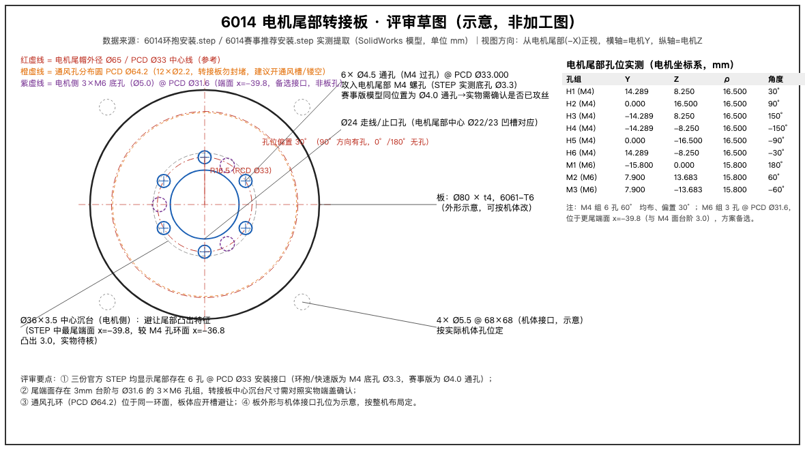

# 机械评审纪要 · 6014 电机安装方案

> **流程状态**：🟡 材料就绪，评审会待机械组排期（建议走中台图纸评审流程提交评审单，并全程飞书会议录制——对照 27 评审录制失效、OA PRD 评审 48 秒空壳的教训）
> 会议日期：待定（评审材料 2026-10-14 就绪）　　地点/线上：待定　　记录人：朱佩韦
> 参会人：待机械组组长确认（建议：机构 SIG + 电控 + 整机负责人）
> 评审对象：6014 关节电机尾部安装方案（转接板路线）　　材料：`adapter_plate_sketch.png`、`adapter_plate.dxf`、`tail_hole_coordinates.csv`
> 关联：[27 机械图纸评审 · 进度跟踪](https://hub.newenergycoder.club/apps/mech-review-6014/)｜[图纸评审流程灰度执行手册](https://hub.newenergycoder.club)（门户「图纸评审」Tab）

## 一、背景与争议点

| # | 争议点 | 提出人观点 | STEP 模型核查结论 |
|---|---|---|---|
| 1 | 电机尾部无螺丝孔，无法固定 | 6014 屁股后面没有螺丝孔 | **不成立**。三份官方 STEP 均显示尾部 6 孔 @ PCD Ø33（环抱/快速版为 M4 底孔 Ø3.3，赛事版为 Ø4.0 通孔） |
| 2 | 环抱安装 3D 打印强度不够 | 打印件支撑不了 | **成立但可规避**。官方抱箍为机加件构型；改用尾部孔 + 铝转接板即可绕开 |
| 3 | 6014 只能给机器狗用 | 专用件 | **不成立**。尾部孔群即通用安装接口，赛事方案还用它做双电机串联 |

## 二、STEP 实测关键数据（评审依据）

- 主安装接口：**6×M4（底孔 Ø3.3）@ PCD Ø33.000**，60° 均布、偏置 30°（90° 方向有孔，0°/180° 无孔），端面 x=-36.8
- 备选接口：3×M6（底孔 Ø5.0）@ PCD Ø31.6，端面 x=-39.8（与 M4 面台阶 3.0mm）
- 同环面通风孔：12×Ø2.2 @ PCD Ø64.2（转接板须开通风槽/镂空）
- 中心：Ø22/23 凹槽（对应转接板 Ø24 走线孔）；尾帽外径 Ø65

## 三、实物待确认项（评审现场逐项核实）

| # | 待确认项 | 确认方法 | 结果 | 确认人 |
|---|---|---|---|---|
| 1 | 尾部 6 孔是否已攻丝 M4（还是 Ø4.0 光孔） | 实物试拧 M4 螺钉 / 卡尺测孔径（Ø3.3=已钻底孔，Ø4.0=通孔） | ☐ 已攻丝　☐ 光孔 | |
| 2 | 尾端面台阶实际高度（模型为 3.0mm）与凸台外径 | 深度尺 / 卡尺 | ____mm / Ø____mm | |
| 3 | 实物版本与模型批次是否一致（"IM6014最新"） | 核对电机铭牌/采购批次 | ☐ 一致　☐ 不一致 | |
| 4 | 通风孔实际位置与数量 | 对照 PCD Ø64.2 目视 | ☐ 一致　☐ 不一致 | |
| 5 | 中心凹槽是否需走线（驱动板出线方式） | 看实物线束走向 | ☐ 需要　☐ 不需要 | |

## 四、评审结论（评审会现场勾选，会后 24h 内同步至中台评审单）

- ☐ **通过**：按转接板方案出加工图（6061-T6，Ø80×t4，6×Ø4.5 @ PCD Ø33）
- ☐ **有条件通过**：先完成第三节确认项，再出图（责任人：______）
- ☐ **驳回**，改走：☐ 铝 CNC 抱箍　☐ 官方钢箍快拆　☐ 其他：__________

## 五、行动项

| # | 事项 | 责任人 | 截止 | 状态 |
|---|---|---|---|---|
| 1 | 实物核实尾部孔/台阶并回填第三节 | | | |
| 2 | 按确认结果出转接板加工图（DXF 已备好） | | | |
| 3 | 确定机体侧接口孔位（替换示意 4×Ø5.5） | | | |
| 4 | 打样与装机验证 | | | |

## 六、签字

机械：__________　　整机：__________　　负责人：__________
